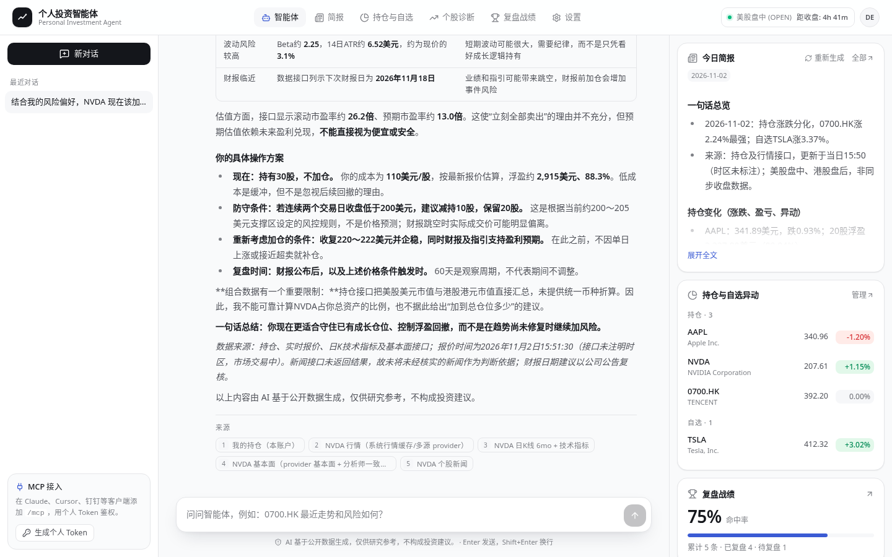
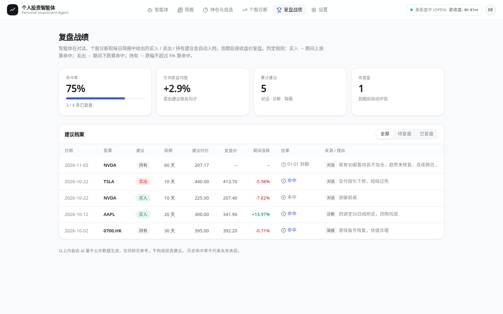
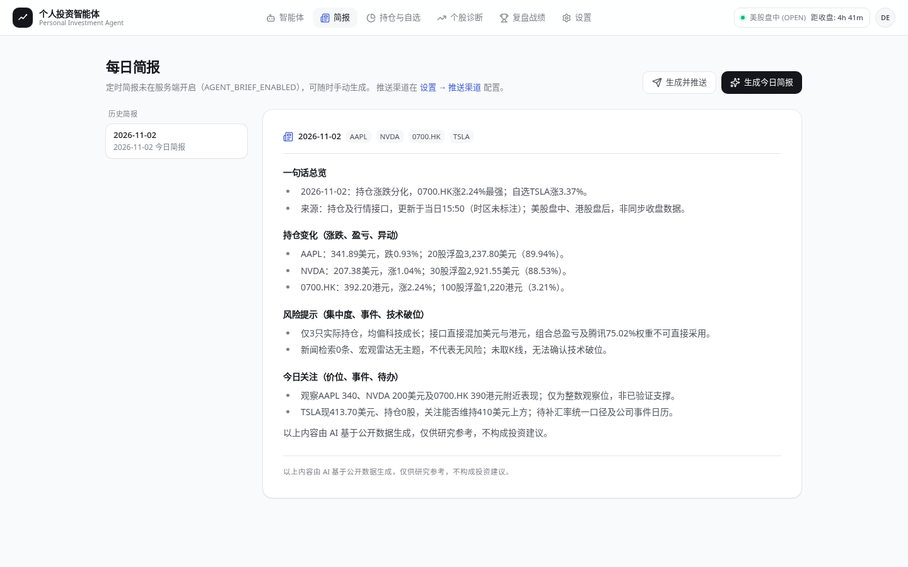
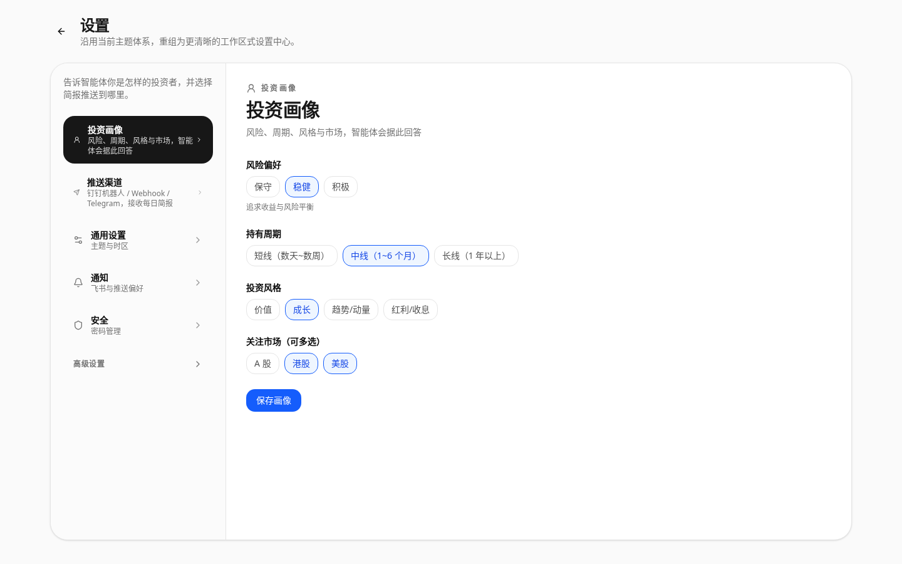
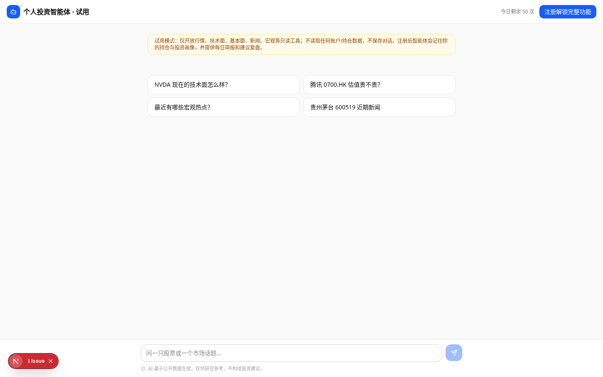

# 你的个人投资智能体 · Personal Investment Agent

> 一个**记得你的持仓与风格**、**每天主动给你写简报**、**每条建议都会被复盘打分**的开源 AI 投资智能体。覆盖 A 股 / 港股 / 美股，可自托管，并可通过 **MCP** 接入 Claude Desktop、Cursor、钉钉数字员工。



## 为什么用它

| | 普通 AI 聊天 | 个人投资智能体 |
|---|---|---|
| 了解你 | 每次从零开始 | 记住持仓、自选与**投资画像**（风险 / 周期 / 风格 / 市场），自动注入每次对话 |
| 主动性 | 你问它才答 | 每天盘前自动生成**今日简报**，推送到钉钉群机器人 / Webhook / Telegram |
| 可信度 | 说完就算 | 每条买入 / 卖出 / 持有建议自动入档，到期按真实行情**复盘**，命中率公开可查 |
| 数据 | 训练数据 / 胡编 | 实时调用行情、K 线技术面、基本面、新闻、宏观工具，回答附来源 |
| 集成 | 封闭 | 标准 **MCP** 服务，任何支持 MCP 的客户端都能调用 |

## 功能

- 🤖 **智能体首页**：登录即进入对话；右侧是今日简报、持仓与自选异动（点一下让智能体解释）和战绩概览。
- 🧠 **投资画像记忆**：注册引导即可设置，随时在 设置 → 投资画像 修改；智能体回答与简报都会参考。
- 📰 **今日简报**：手动生成或定时（`AGENT_BRIEF_ENABLED=true`）；支持钉钉加签机器人、通用 Webhook、Telegram（可选）。
- 🏆 **复盘战绩**：从对话、个股诊断、简报中自动提取建议（标的、方向、周期、理由、当时价格），到期自动评估；页面展示命中率、方向收益与明细。
- 🔌 **MCP 接入**：`/mcp`（Streamable HTTP），7 个只读数据工具 + `ask_stock_agent` 完整智能体。
- 🧪 **免登录试用 `/try`**：仅开放只读行情/新闻/宏观工具，不访问任何账户数据，按 IP 每日限额。
- 🔑 **高级设置**：自带模型 Key（BYOK）、多供应商路由、数据源配置（默认折叠）。
- 📊  次级入口：个股诊断、持仓管理（原仪表盘，现位于 `/dashboard`）。

| 复盘战绩 | 今日简报 |
|---|---|
|  |  |
| **投资画像** | **免登录试用** |
|  |  |

> 截图中的部分复盘记录为演示数据。

## 5 分钟快速开始（只需要一个 LLM Key）

`docker-compose.quickstart.yml` 自带 PostgreSQL + Redis，只需要任意一个 **OpenAI 兼容**的模型接口（DeepSeek、通义千问、OpenAI、自建中转等，支持 tool calling 效果最好）。

```bash
git clone https://github.com/breeze-lyf/ai-stock-advisor.git && cd ai-stock-advisor
cp .env.quickstart.example .env.quickstart
# 编辑 .env.quickstart：填 LLM_BASE_URL / LLM_MODEL / LLM_API_KEY，并生成 SECRET_KEY 与 ENCRYPTION_KEY
docker compose -f docker-compose.quickstart.yml --env-file .env.quickstart up -d --build
```

打开 <http://localhost:3000>：注册 → 填写投资画像 → 添加几只持仓/自选 → 和智能体对话、生成今日简报。数据库迁移在后端启动时自动执行。

## 用 MCP 接入 Claude Desktop / Cursor

1. 登录后在智能体页面左下角「MCP 接入」点击 **生成个人 Token**（`asa_` 开头，只显示一次）。
2. 在客户端配置 MCP 服务（把地址换成你的部署域名；本地为 `http://localhost:8000/mcp`）。

**Claude Desktop**（`claude_desktop_config.json`，通过 `mcp-remote` 桥接远程 HTTP 服务）：

```json
{
  "mcpServers": {
    "investment-agent": {
      "command": "npx",
      "args": ["-y", "mcp-remote", "https://your-domain.com/mcp", "--header", "Authorization:Bearer asa_xxx"]
    }
  }
}
```

**Cursor**（`~/.cursor/mcp.json` 或项目内 `.cursor/mcp.json`）：

```json
{
  "mcpServers": {
    "investment-agent": {
      "url": "https://your-domain.com/mcp",
      "headers": { "Authorization": "Bearer asa_xxx" }
    }
  }
}
```

可用工具：`get_quote`、`get_kline_and_technicals`、`get_fundamentals`、`search_news`、`macro_snapshot`、`get_portfolio`、`run_stock_diagnosis`、`ask_stock_agent`。详见 [docs/agent-p1.md](docs/agent-p1.md) 与 [docs/agent-p2.md](docs/agent-p2.md)。

## ⚠️ 免责声明

本项目所有内容（对话、简报、诊断、复盘统计）均由 AI 基于公开数据自动生成，**仅供研究与学习参考，不构成任何投资建议**，亦不提供任何收益承诺。历史命中率不代表未来表现。市场有风险，投资需独立决策并自行承担后果。本项目不是自动交易系统，不会替你下单。

---

## English

**Personal Investment Agent** is an open-source, self-hostable AI agent for individual investors (China A-shares, Hong Kong and US stocks).

- **Knows you** – remembers your holdings, watchlist and investment profile (risk, horizon, style, markets) and injects them into every conversation.
- **Proactive** – writes a daily pre-market brief and pushes it to a DingTalk robot, a generic webhook or Telegram.
- **Accountable** – every BUY / SELL / HOLD call is logged and automatically scored after its horizon; hit rate is shown on the *Review* page.
- **MCP-native** – exposes a Streamable-HTTP MCP server at `/mcp` (personal bearer token), usable from Claude Desktop, Cursor, DingTalk and others.
- **Try without sign-up** at `/try` (read-only market tools, per-IP daily quota).

Quick start: copy `.env.quickstart.example` to `.env.quickstart`, set an OpenAI-compatible `LLM_*` endpoint plus `SECRET_KEY`/`ENCRYPTION_KEY`, then run `docker compose -f docker-compose.quickstart.yml --env-file .env.quickstart up -d --build` and open http://localhost:3000.

*Disclaimer: all output is AI-generated from public data for research purposes only and is **not investment advice**.*

---

## 开发者文档

### 技术栈

| 模块                 | 技术                                                       |
| -------------------- | ---------------------------------------------------------- |
| Web Frontend         | Next.js 16, React 19, TypeScript, Tailwind CSS 4, Radix UI |
| Backend              | FastAPI, SQLAlchemy Async, Alembic, Pydantic               |
| Database             | PostgreSQL / Neon                                          |
| Cache / Coordination | Redis                                                      |
| AI Provider          | 系统内置模型 + 用户 BYOK，多 Provider 路由与容灾           |
| Market Data          | A/H/US 行情、多源 Provider、缓存与后台刷新                 |
| Deployment           | Docker, GitHub Actions, Aliyun ACR, server pull mode       |

### 已落地能力

当前功能状态以 `docs/05_Current_Feature_Status_Matrix.md` 为准。高层概览如下：

- 已完成：注册登录、用户设置、持仓管理、组合汇总、股票搜索、A/H/US 行情、单股 AI 诊断、组合 AI 分析、宏观雷达、通知中心、飞书警报、AI 模型管理、模拟交易基础、监控诊断接口、自动部署链路。
- 部分完成：StockCapsule、增强分析、财经日历、选股器、Truth Tracker 可视化、FREE/PRO 分层。
- 骨架已入库：量化因子、回测引擎、自选分组、组合风险、订阅支付、Academy。

### 快速启动

#### 统一启动

```bash
./scripts/start.sh dev
```

默认行为：

- Frontend: `http://localhost:3000`
- Backend: `http://localhost:8000`
- Backend env: `backend/.env`
- Runtime logs: `backend/.local/runtime-logs/`
- 后端启动时会执行代理环境标准化、系统模型注册和后台调度初始化。

#### 手动启动

Backend:

```bash
cd backend
../.venv/bin/python -m uvicorn app.main:app --reload --host 0.0.0.0 --port 8000
```

Frontend:

```bash
cd frontend
npm run dev -- -p 3000
```

#### Docker 启动

```bash
./scripts/start.sh docker
```

或：

```bash
docker compose up --build -d
```

### 常用命令

安装依赖：

```bash
npm run install-all
```

前端检查：

```bash
cd frontend
npm run lint
npm run build
npm run generate-types
```

后端测试：

```bash
pytest backend/tests/unit -q
pytest backend/tests/integration -q
RUN_PROVIDER_NETWORK_TESTS=1 pytest backend/tests/provider -q
```

数据库迁移：

```bash
cd backend
alembic revision --autogenerate -m "your_migration_name"
alembic upgrade head
```

### 环境变量 

本地开发主要依赖 `backend/.env` 和前端公开环境变量。

关键项：

- `DATABASE_URL`: PostgreSQL / Neon 连接。
- `SECRET_KEY`: 后端鉴权密钥。
- `REDIS_URL`: Redis 连接，影响缓存、通知去重和调度锁。
- AI Provider keys: 系统内置模型供应商密钥。
- `NEXT_PUBLIC_API_URL`: 前端访问后端 API 的地址。

敏感信息不要提交到仓库，不要写入日志，不要在截图或最终总结中展示。

### 架构入口

```text
frontend/
  app/                  Next.js App Router 页面编排
  components/           业务组件和 UI primitives
  features/             领域 API、hooks、状态逻辑
  shared/api/client     统一 API client
  types/schema.d.ts     OpenAPI 生成类型

backend/
  app/api/v1/endpoints/ FastAPI routers
  app/application/      用例编排
  app/services/         业务服务、AI 路由、行情、调度、通知
  app/models/           SQLAlchemy ORM
  app/schemas/          Pydantic contracts
  migrations/           Alembic migrations
  tests/                unit / integration / provider tests

docs/                   长期基线文档
scripts/                启动、部署和运维脚本
image/                  设计、蓝图和产品素材
```

### 开发规则

- 后端 router 保持薄层，复杂业务放到 `application/**` 或 `services/**`。
- 前端页面层只做路由和编排，接口调用优先放到 `frontend/features/**/api.ts` 或共享 API client。
- 接口结构变化必须同步：后端 schema、OpenAPI、前端生成类型、API wrapper、UI 和相关文档。
- 数据库结构变化必须走 Alembic migration，不手改线上表结构。
- AI Provider/BYOK 相关逻辑必须走 `ai_service.py`、`model_resolver.py`、`provider_router.py` 既有链路。
- Provider/network 测试依赖外部网络和代理状态，默认不作为稳定 CI 前置，相关任务中显式运行。

### AI 协作记忆

本仓库同时维护面向 AI 编程助手的长期上下文：

- `AGENTS.md`: Codex 项目说明书，记录默认语言、安全约束、架构契约、命令、分层规则和交付要求。
- `CLAUDE.md`: 如果存在，用于 Claude Code 读取项目约定。
- `docs/08_Agent_Decision_Log.md`: 记录 AI 协作中产生的长期产品判断、现实假设和架构权衡。

会影响未来开发判断的产品、架构、依赖、安全或测试策略决定，应追加到 `docs/08_Agent_Decision_Log.md`，不要把根目录 README 变成会话流水账。

### 文档入口

- `docs/README.md`: 文档索引和维护规则。
- `docs/01_Product_Requirements_Document.md`: 产品目标、范围边界、阶段规划。
- `docs/02_Developer_SOP_and_Guide.md`: 开发执行规范、分层约束、交付规则。
- `docs/03_Mainland_Deployment_Guide.md`: 大陆环境部署和网络适配。
- `docs/04_Database_Design.md`: 数据库结构和设计意图。
- `docs/05_Current_Feature_Status_Matrix.md`: 功能状态、测试优先级和最小回归集。
- `docs/06_AI_Analysis_Implementation_Guide.md`: AI 增强分析架构与实现。
- `docs/07_Agent_Architecture_Design.md`: Agent 任务拆解和输出规范。
- `docs/08_Agent_Decision_Log.md`: AI 协作决策日志。

### 部署

生产推荐使用“GitHub Actions 构建镜像，服务器只拉镜像和编排启动”的模式，适合低配服务器。

- Workflow: `.github/workflows/deploy.yml`
- Compose: `docker-compose.prod.yml`
- Deploy script: `scripts/deploy_compose_prod.sh`
- Image registry: Aliyun ACR

部署相关 secrets 包括 ACR、SSH、服务器地址和前端公开 API 地址，均通过 GitHub Actions secrets 管理。

### 维护约定

- 根目录 README 只保留项目首页、快速启动、架构入口和协作规则。
- 长期基线写入 `docs/`。
- 阶段性总结、一次性方案和历史材料放到 `docs/archive/<yyyy-mm>/`。
- 文档优先级：代码实际行为 > `docs/05` 状态矩阵 > `docs/02` SOP > `docs/01` PRD。
- 如果文档与代码不一致，在相关变更中同步修正文档。
